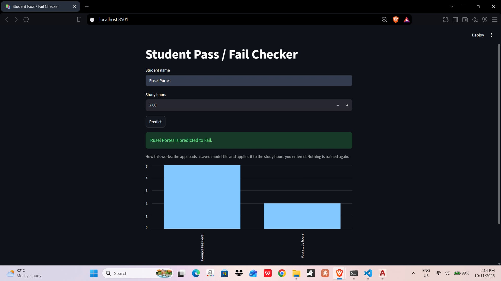

# Rusel — Student Pass / Fail Checker

A three-part exercise showing how one machine-learning model can be reused three
different ways: saved to disk, exposed as an API, and wrapped in a web interface.



## What's inside

```
rusel/
├── requirements.txt
├── exercise1/
│   ├── train_model.py           # trains the model and saves it with joblib
│   ├── load_and_predict.py      # loads the saved model and predicts (no retraining)
│   └── rusel_pass_model.joblib  # the saved model file
├── exercise2/
│   └── app.py                   # Flask API exposing /predict
└── exercise3/
    └── streamlit_app.py         # Streamlit web interface
```

## The model

- **Algorithm:** Decision Tree Classifier (gini criterion, `random_state=1`)
- **Input:** study hours (one feature, passed as a pandas DataFrame)
- **Output:** Pass (1) or Fail (0)
- **Training data:** 10 samples — 1–4 hours → Fail, 5–10 hours → Pass

Once trained, the model is saved to `rusel_pass_model.joblib` with `joblib.dump()`.
Every other script only *loads* that file; nothing is ever retrained.

## Setup

```bash
pip install -r requirements.txt
```

## How to run

### Exercise 1 — Model persistence

Train once, then predict from the saved file:

```bash
cd exercise1
python train_model.py        # writes rusel_pass_model.joblib
python load_and_predict.py   # prints Pass/Fail for low, medium, and high hours
```

`load_and_predict.py` output:

```
 study_hours  prediction
         1.5        Fail
         5.0        Pass
         9.5        Pass
```

### Exercise 2 — Flask API

```bash
cd exercise2
python app.py                # runs on http://127.0.0.1:5000
```

Test it with curl:

```bash
curl -X POST http://127.0.0.1:5000/predict ^
  -H "Content-Type: application/json" ^
  -d "{\"study_hours\": 10, \"attendance_percentage\": 90}"
```

Expected response:

```json
{
  "study_hours": 10.0,
  "attendance_percentage": 90.0,
  "prediction": "Pass"
}
```

Validation behaviour (all return status 400):

| Case | Body |
|---|---|
| Body is not JSON | `{"error": "Request body must be JSON."}` |
| Missing field | `{"error": "Missing field: study_hours"}` |
| Non-numeric value | `{"error": "study_hours must be numeric."}` |
| Attendance outside 0–100 | `{"error": "attendance_percentage must be between 0 and 100."}` |

> **Note:** the model was only trained on study hours, so `attendance_percentage`
> is validated and echoed back but does not affect the prediction.

### Exercise 3 — Streamlit interface

```bash
cd exercise3
streamlit run streamlit_app.py   # opens http://localhost:8501
```

Enter a student's name, set the study hours, and press **Predict**. The app
shows the Pass/Fail result plus a bar chart comparing the entered hours with
the example pass level.

Both the Flask app and the Streamlit app look for `rusel_pass_model.joblib`
next to their own file first, and fall back to `exercise1/` if it isn't there —
so Exercise 1 only needs to be run once.
